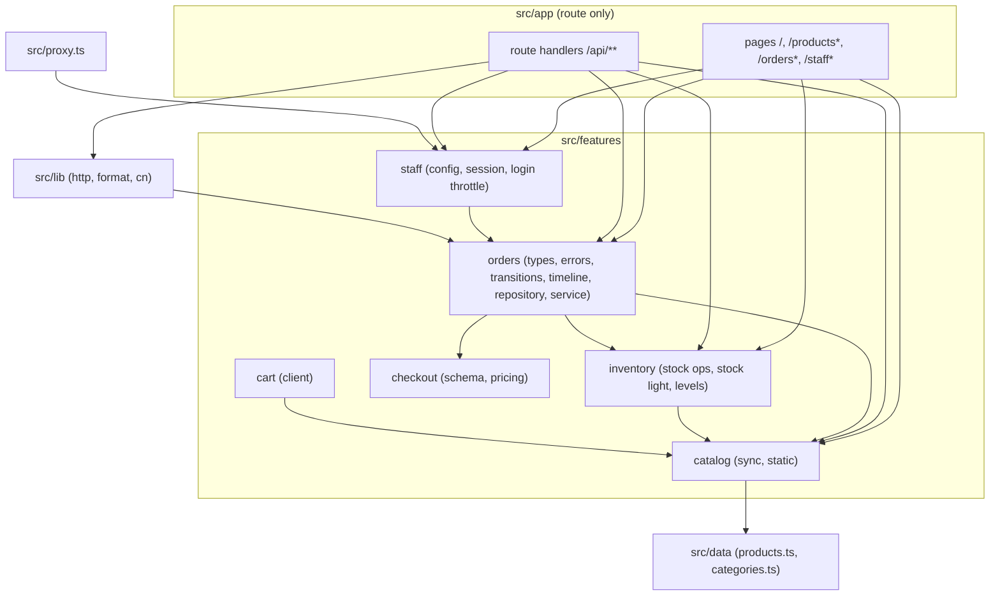
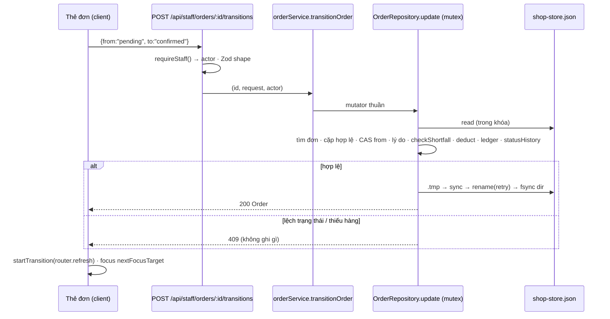
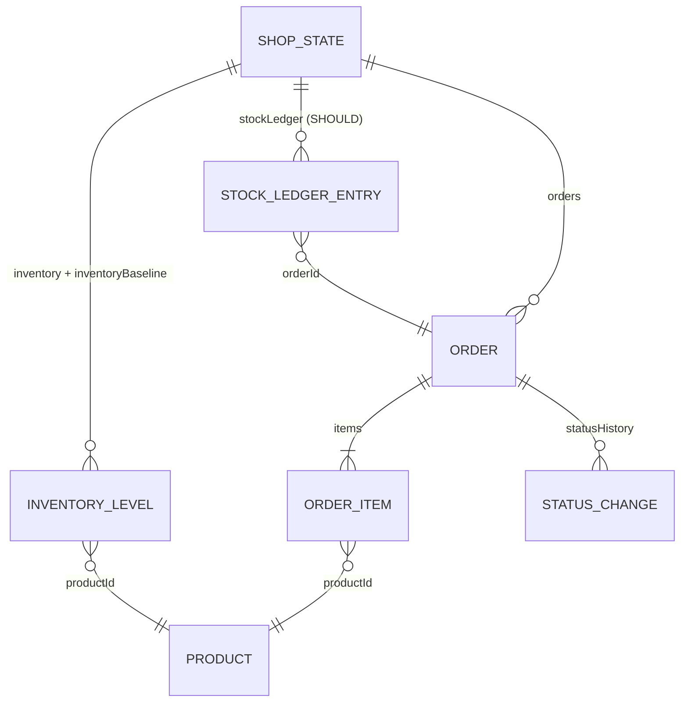

# Architecture Spine — ShopLite: Vận hành đơn hàng

## Design Paradigm

**Modular monolith theo feature** (một app Next.js, một tiến trình Node) với **functional core / imperative shell**:

- **Core (thuần, có test):** bảng chuyển trạng thái, kiểm tra/trừ/hoàn tồn kho, Đèn tồn kho, Ngày dự kiến giao, timeline, thông điệp xung đột, chuỗi thanh toán. Nhận snapshot, trả snapshot mới hoặc ném `OrderError`. Không I/O; thời điểm luôn nhận qua `now`.
- **Shell:** service (`createOrderService(deps)`, `createInventoryService(deps)`) điều phối; **port** `OrderRepository` (mở rộng) lưu toàn bộ trạng thái; adapter JSON-file (production) và in-memory (test).
- **Route:** `src/app/**` chỉ gồm page, layout, route handler; không chứa logic nghiệp vụ.



Mũi tên = được phép import; không có chiều ngược lại. `inventory` chỉ chứa hàm thuần và kiểu, **không** import `orders` và không có I/O riêng. `staff → orders` và `lib → orders` chỉ để dùng `order-errors.ts`. `proxy.ts` chỉ import `staff/session.ts` và `staff/staff-config.ts` (thuần, không fs).

## Invariants & Rules

### AD-1 — Bố cục feature và ranh giới server [ADOPTED]

- **Binds:** all
- **Prevents:** logic rơi vào `src/app`; module đọc file bị bundle vào client.
- **Rule:** Code nghiệp vụ nằm ở `src/features/<feature>/`; feature mới là `staff` và `inventory`. `src/app` chỉ có route. Instance có I/O xuất qua `features/<feature>/server.ts`, chỉ import từ Server Component và Route Handler. Client component nhận dữ liệu qua props hoặc gọi API. `cacheComponents` giữ **tắt**; mọi page import `features/*/server.ts` phải `export const dynamic = "force-dynamic"`.

### AD-2 — Hàm thuần có test; service nhận deps [ADOPTED]

- **Binds:** FR-8..FR-23
- **Prevents:** logic chuyển trạng thái/tồn kho nằm rải trong route hoặc component, không test được.
- **Rule:** Quy tắc nghiệp vụ là hàm thuần kèm `*.test.ts` cạnh nó: `orders/order-transitions.ts`, `orders/timeline.ts`, `orders/delivery-estimate.ts`, `orders/public-order.ts`, `inventory/stock.ts`. `createOrderService({ repository, findProduct?, now?, generateId? })` **giữ nguyên chữ ký** (test hiện có dựng bằng `{ repository }`).

### AD-3 — Một file trạng thái, ghi nguyên tử (PA1 của addendum)

- **Binds:** FR-5, FR-9, FR-11, FR-12, FR-20, SM-1, SM-2
- **Prevents:** đơn `confirmed` mà kho chưa trừ (hoặc ngược lại) sau khi tiến trình chết; hai file lệch nhau.
- **Rule:**
  - Đơn hàng, Tồn kho, mốc khởi tạo và (FR-20) Sổ kho nằm trong **một** file `STORE_FILE` (mặc định `storage/shop-store.json`): `ShopState = { schemaVersion: 1, orders: Order[], inventory: Record<productId, number>, inventoryBaseline: Record<productId, number>, stockLedger?: StockLedgerEntry[] }`.
  - Commit: `mkdir -p` → mở `<file>.tmp` bằng `FileHandle`, ghi, `handle.sync()`, đóng → `rename` (retry khi `EPERM`/`EACCES`/`EBUSY`, tối đa 5 lần, backoff 20→320 ms) → `fsync` thư mục chứa (bỏ qua trên `win32`). Hết retry thì ném lỗi, file cũ còn nguyên.
  - Không có đường ghi nào khác vào file này. `.tmp` sót lại bị bỏ qua khi đọc, bị ghi đè ở commit sau.

### AD-4 — `OrderRepository` mở rộng là port duy nhất; mọi đọc/ghi trạng thái đi qua mutex

- **Binds:** FR-2, FR-3, FR-7..FR-12, FR-22
- **Prevents:** quyết định dựa trên bản đọc cũ rồi ghi đè thay đổi của người khác; hai đường ghi khác tầng khóa.
- **Rule:**
  - Interface [ADOPTED, mở rộng additive]: `findAll()`, `findById(id)`, `save(order)` giữ nguyên; thêm `readState(): Promise<ShopState>` và `update<T>(mutator: (s: ShopState) => { state: ShopState; result: T }): Promise<T>`. Cả adapter JSON (`createJsonFileShopRepository`) và in-memory (`createInMemoryOrderRepository(seedOrders?, { inventory?, failNextCommit? })`) cài đủ, và đều có mutex.
  - **Mọi** phương thức (kể cả đọc) chạy trong mutex. `update` giữ khóa suốt đọc → mutator → commit; khóa luôn được nhả trong `finally`. Mutator **đồng bộ, thuần**, nhận bản sao; ném `OrderError` thì không ghi gì.
  - Mọi quyết định trên đơn **đã tồn tại** (hủy của khách, chuyển của nhân viên, yêu cầu hủy) nằm **trong mutator**. `save` chỉ dùng để thêm đơn mới (`placeOrder`) và để dựng dữ liệu trong test; không có code production nào đọc đơn rồi `save` lại.
  - Trước commit, adapter kiểm tra: mọi `inventory[id]` là số nguyên `>= 0`, `id` đơn duy nhất; vi phạm thì ném, không ghi.
  - Mutex: một instance mỗi file trong tiến trình, lưu trên `globalThis` theo khóa `path.resolve(file)` (chữ thường trên `win32`).
  - Không cache trạng thái trong bộ nhớ.

### AD-5 — Một tiến trình được cưỡng chế

- **Binds:** PRD §5, AD-4
- **Prevents:** hai tiến trình (dev + E2E, `next start` chạy hai lần, script) cùng ghi một file mà mutex không thấy nhau.
- **Rule:** Lần truy cập store đầu tiên tạo `<STORE_FILE>.lock` bằng cờ `wx`, ghi PID. Lock đã có và PID còn sống → ném lỗi khởi động rõ ràng; PID đã chết → ghi đè. Xóa lock khi tiến trình thoát bình thường. Script vận hành (AD-16) tôn trọng cùng lock.

### AD-6 — Điểm chèn lỗi cho kiểm thử nguyên tử (FR-9, FR-10)

- **Binds:** FR-9, FR-10, SM-1
- **Prevents:** tính nguyên tử chỉ được "tin" chứ không được chứng minh.
- **Rule:** Adapter JSON nhận `fs` port inject được (`mkdir`, `open` → `FileHandle{ writeFile, sync, close }`, `rename`, `readFile`, `fsyncDir`). In-memory nhận `failNextCommit`. Test bắt buộc:
  - (a) lỗi ở `writeFile` / `sync` / `rename` → tạo repository **mới** trên cùng file (mô phỏng khởi động lại) → đơn vẫn `pending`, kho không đổi.
  - (b) trên **file thật trong `mkdtemp`**: `Promise.all` hai xác nhận cùng đơn → một 200, một 409, kho trừ một lần; hai đơn tranh món cuối → một thành công, một `INSUFFICIENT_STOCK`, kho = 0; xác nhận chạy song song với hủy của khách → đúng một thắng, kho khớp trạng thái thắng.
  - (c) `rename` ném `EPERM` hai lần rồi thành công → commit thành công.

### AD-7 — Bảng chuyển trạng thái, compare-and-set trong mutex, thứ tự kiểm tra

- **Binds:** FR-2, FR-8, FR-9, FR-10, FR-11, FR-12, FR-15
- **Prevents:** trừ kho hai lần; UI và server hiểu "hành động hợp lệ" khác nhau; cùng lỗi trả mã khác nhau.
- **Rule:**
  - Một bảng `ORDER_TRANSITIONS` duy nhất trong `orders/order-transitions.ts` (đúng 6 dòng FR-8, kèm tác động kho và vai trò được phép). UI (FR-15) suy nút từ chính bảng này.
  - Mọi yêu cầu chuyển mang `from` tường minh. Thứ tự kiểm tra cố định: (1) body sai shape → 400 `VALIDATION_ERROR`; (2) không có đơn → 404 `ORDER_NOT_FOUND`; (3) cặp `from→to` không có trong bảng → 409 `INVALID_STATUS_TRANSITION` "Không thể chuyển từ ‹nhãn› sang ‹nhãn›"; (4) `order.status !== from` → 409 `INVALID_STATUS_TRANSITION`, `message = describeStatusChange(order)`, `details = { currentStatus }`; (5) quy tắc lý do hủy → 400 `VALIDATION_ERROR`; (6) thiếu hàng → 409 `INSUFFICIENT_STOCK`. Bước 2–6 chạy trong mutator.
  - `pending→confirmed`: kiểm tra **mọi** dòng trước; thiếu → `details[productId] = "‹tên›: cần N, còn M, thiếu K"`, message "Không đủ hàng để xác nhận"; đủ → trừ hết, `stockApplied = true`.
  - Hoàn kho (`confirmed→cancelled`; `shipping→cancelled` với `returnedToShop: true`) chỉ khi `stockApplied === true`, hoàn đúng `items[].quantity`, rồi `stockApplied = false`.
  - Kiểm tra, trừ/hoàn kho, dòng Sổ kho và `statusHistory` xảy ra trong **cùng một** mutator.

### AD-8 — Hai đường hủy tách biệt; endpoint khách giữ nguyên

- **Binds:** FR-2, FR-4, FR-11, FR-12, FR-22
- **Prevents:** nới lỏng quyền của khách khi thêm quyền nhân viên.
- **Rule:** `orderService.cancelOrder(id)` (khách, `PATCH /api/orders/:id` body `{status:"cancelled"}`, không auth) chỉ cho `pending→cancelled`, giữ nguyên mã lỗi và thông điệp hiện có, actor `{kind:"customer"}`, chạy bằng `repository.update`. Nhân viên dùng `orderService.transitionOrder(id, request, actor)`. Khách không gọi được `transitionOrder`.

### AD-9 — Tồn kho lưu bền; catalog giữ đồng bộ, overlay ở ranh giới server

- **Binds:** FR-3, FR-5, FR-14, FR-21
- **Prevents:** hai nguồn tồn kho cùng được đọc; lan `async` vào catalog; Đèn tồn kho có hai cách tính.
- **Rule:**
  - Nguồn sự thật = `ShopState.inventory`. Khởi tạo (AD-15) ghi **đủ mọi** sản phẩm vào `inventory` và `inventoryBaseline` từ `stock` trong `products.ts`. Sản phẩm mới xuất hiện trong `products.ts` được thêm key (cả baseline) ở `update` kế tiếp, trong mutex, bằng một hàm duy nhất `reconcileInventoryKeys(state, products)`. Sau khởi tạo, sửa `stock` trong `products.ts` **không** đổi tồn kho.
  - `catalog-service` giữ **đồng bộ, thuần**. Thêm tham số tùy chọn `source: Product[] = products` cho `getProductBySlug`, `getFeaturedProducts`, `getRelatedProducts` (như `queryProducts` đã có). Ranh giới server gọi `withLiveStock(products, levels)` — trả **mảng/đối tượng mới**, không sửa `products` — rồi truyền làm `source`.
  - Chỗ gọi bị ảnh hưởng: `/api/products`, `/api/products/[slug]`, `/`, `/products`, `/products/[slug]` (bỏ `generateStaticParams`, thêm `force-dynamic`), `placeOrder` (kiểm tra stock trong mutator trên `state.inventory`, thông điệp giữ nguyên), Hàng đợi, Chi tiết đơn nhân viên.
  - Hàng đợi và Chi tiết đọc đơn và tồn kho từ **cùng một** `readState()`. Đèn tồn kho chỉ tính bằng `getStockLight(order, inventory)` trong `inventory/stock.ts`.
  - Client (`cart`, `StockBadge`, `AddToCartButton`) không đổi: nhận `stock` qua props. `stock` trong giỏ localStorage vẫn là ảnh chụp.
  - Chỉ mutator của `orders` đổi `inventory`, qua hàm thuần `inventory/stock.ts` (`checkShortfall`, `deduct`, `restock`); `deduct`/`restock` trả kèm các `StockLedgerEntry` — đây là nơi **duy nhất** sinh dòng Sổ kho.

### AD-10 — Mô hình `Order` chỉ mở rộng bằng trường tùy chọn; `statusHistory` là nguồn Mốc giờ duy nhất

- **Binds:** FR-4, FR-7, FR-11, FR-12, FR-16..FR-19, FR-22, FR-23
- **Prevents:** map Mốc giờ và lịch sử lệch nhau; đơn cũ gây 500; dữ liệu bịa; một story xóa trường của story khác.
- **Rule:** Trường cũ không đổi tên/xóa. Trường mới đều optional:

  ```ts
  type Actor = { kind: "staff"; name: string } | { kind: "customer" };
  interface StatusChange { from: OrderStatus | null; to: OrderStatus; at: string; actor: Actor }
  type CancelReason = "out_of_stock" | "customer_changed_mind" | "unreachable" | "other" | "delivery_failed";
  interface Order { /* ...trường hiện có... */
    statusHistory?: StatusChange[];          // dòng đầu: from null → pending, actor customer
    cancellation?: { reason?: CancelReason; note?: string; returnedToShop?: boolean };
    stockApplied?: boolean;
    flags?: { cancelRequestedAt?: string };  // Cờ phụ (FR-22)
  }
  ```

  - Mốc giờ, Người thao tác, thời gian chờ, cảnh báo đứng yên đều **suy ra** bằng hàm thuần trong `orders/timeline.ts`. Đơn cũ: mốc "đặt" = `createdAt`, mốc khác thiếu → "—". Sắp xếp Hàng đợi dùng `enteredStatusAt = mốc vào trạng thái hiện tại ?? (pending ? createdAt : updatedAt)`. Không ghi bù dữ liệu vào đơn cũ.
  - Schema Zod của `ShopState`/`Order` dùng `z.looseObject` ở **mọi cấp** (giữ nguyên trường lạ khi đọc → ghi); có test round-trip giữ trường không khai báo.
  - Thời điểm lưu ISO UTC; hiển thị bằng `formatDateTime` và `formatTime` (HH:mm), cùng múi `Asia/Ho_Chi_Minh`, trong `src/lib/format.ts`.

### AD-11 — Dữ liệu công khai cho khách

- **Binds:** FR-4, FR-16, FR-17, EXPERIENCE (trang khách không hiện tên Nhân viên)
- **Prevents:** tên nhân viên, ghi chú nội bộ lộ qua API không cần đăng nhập.
- **Rule:** Mọi response và trang của khách (`GET/POST /api/orders`, `GET/PATCH /api/orders/:id`, `/orders`, `/orders/[id]`) đi qua `toPublicOrder(order)` (`orders/public-order.ts`): giữ mọi trường hiện có; `statusHistory[].actor` chỉ còn `{ kind }`; bỏ `cancellation.note`, `stockApplied`. API nhân viên trả `Order` đầy đủ.

### AD-12 — Thông điệp và chuỗi hiển thị suy ra từ hàm thuần

- **Binds:** FR-10, FR-16, FR-17, FR-23
- **Prevents:** mỗi màn hình ghép câu khác nhau ("Đã đã xác nhận…").
- **Rule:** Trong `orders/timeline.ts` / `orders/delivery-estimate.ts`, mỗi hàm có test:
  - `describeStatusChange(order)` dùng bảng động từ: `confirmed` "Đã xác nhận", `shipping` "Đã bắt đầu giao", `delivered` "Đã giao", `cancelled` "Đã hủy"; actor "bởi ‹tên›" hoặc "bởi khách"; "lúc HH:mm". Đơn cũ không có lịch sử: "Đơn đã ở trạng thái ‹nhãn›".
  - `estimateDelivery(order)`: đếm ngày làm việc (T2–T6, không tính lễ) **bắt đầu từ ngày làm việc kế tiếp** sau mốc `confirmed` theo giờ VN; khoảng = [ngày thứ `minDays`, ngày thứ `maxDays`]. Ví dụ: confirmed T7 21/11/2026 → tiêu chuẩn 25–27/11, nhanh 23–24/11. `pending` → "Sẽ có sau khi shop xác nhận"; `delivered` → ngày giao thực tế; `cancelled` → ẩn; thiếu mốc `confirmed` (đơn cũ) → "—". FR-23 "quá hạn" = sau 23:59 ngày cuối khoảng.
  - `describePayment(order)`: theo FR-16; `cancelled` + `cod` → "Đơn đã hủy, không cần thanh toán"; `cancelled` + `bank_transfer` → "Chuyển khoản: ‹tổng› · liên hệ shop nếu đã chuyển".

### AD-13 — Xác thực Nhân viên: PIN + cookie ký HMAC; proxy lạc quan, kiểm tra thật tại server

- **Binds:** FR-6, FR-7, FR-13..FR-15, FR-19, FR-21
- **Prevents:** route staff quên kiểm tra quyền; phiên giả mạo; vòng lặp redirect; open redirect; Khu nhân viên mở khi thiếu cấu hình.
- **Rule:**
  - Cấu hình: `STAFF_PINS="An:123456,Hoa:654321"` (PIN 6–8 chữ số, tên và PIN không trùng, parse bằng Zod) và `STAFF_SESSION_SECRET` (≥ 32 ký tự), đọc chỉ trong `staff/staff-config.ts`. Thiếu/sai → mọi đăng nhập và API staff trả 401 `UNAUTHORIZED`, trang đăng nhập hiện "Khu nhân viên chưa được cấu hình".
  - So PIN: `HMAC-SHA256(secret, pin)` so với digest của từng PIN cấu hình bằng `timingSafeEqual` (độ dài cố định), duyệt hết danh sách. Thông điệp sai luôn "PIN không đúng". PIN không vào response, log, file trạng thái.
  - Phiên: cookie `shoplite_staff` = `base64url(JSON{name, exp}).base64url(HMAC-SHA256)`, `httpOnly`, `SameSite=Lax`, `Secure` khi `NODE_ENV=production`, `Path=/`, `Max-Age` 12 giờ. Xác minh: chữ ký (`timingSafeEqual`), `exp`, `name` còn trong `STAFF_PINS`. Không lưu phiên phía server.
  - Route: trang bảo vệ nằm trong `src/app/staff/(protected)/` (`page.tsx` = Hàng đợi, `orders/[id]/page.tsx`); `layout.tsx` của group gọi `requireStaff()`. `/staff/login` nằm ngoài group.
  - `src/proxy.ts`, matcher `/staff/:path*`: `/staff/login` → cho qua ngay; cookie thiếu → redirect `/staff/login?next=<path>`; cookie có nhưng sai/hết hạn → thêm `&reason=expired`. Chỉ là kiểm tra lạc quan.
  - **Authoritative:** `requireStaff()` (`staff/server.ts`) ở layout `(protected)` và **đầu mọi** handler `/api/staff/**` (trừ `POST/DELETE /api/staff/session`); handler trả 401, page redirect `/staff/login`. Actor lấy từ phiên, không bao giờ từ body.
  - `next` chỉ được nhận khi bắt đầu bằng `/staff` và không chứa `//` hay `\`; ngược lại dùng `/staff`.

### AD-14 — Chống dò PIN (chốt PRD OQ-6)

- **Binds:** FR-6
- **Prevents:** dò PIN; một người lạ khóa được cả shop (kể cả bằng hàng chờ dài vô hạn); giới hạn dựa trên header client tự đặt.
- **Rule:** `staff/login-throttle.ts` (singleton `globalThis`): mọi lần kiểm PIN chạy **tuần tự** qua một mutex. Sau mỗi lần sai, giữ mutex thêm `min(1s × 2^(n−1), 30s)` với `n` = số lần sai toàn cục trong 15 phút gần nhất; đăng nhập đúng đặt `n = 0`. Hàng chờ có giới hạn: khi đã có **5** lần kiểm đang chờ mutex, request mới bị trả ngay 401 `UNAUTHORIZED` "Đang có nhiều lần thử, vui lòng thử lại sau" mà không vào hàng, nên kẻ dò PIN không chặn được Nhân viên thật quá 5 × 30s. Không khóa cứng, không dựa vào IP, không có mã lỗi mới ngoài `UNAUTHORIZED`. Bộ đếm mất khi restart (chấp nhận).

### AD-15 — Khởi tạo và chuyển dữ liệu cũ (FR-5, FR-18)

- **Binds:** FR-5, FR-18
- **Prevents:** mất đơn trong `storage/orders.json`; khởi tạo chạy hai lần; nhập 0 đơn từ file hỏng.
- **Rule:** `ensureInitialized()` chạy **trong mutex** ở thao tác đầu tiên và kiểm tra lại `STORE_FILE` sau khi lấy khóa. Nếu chưa có: đọc `ORDERS_FILE` (mặc định `storage/orders.json`) bằng `importLegacyOrders(file)` — không có file → `[]`; có file nhưng không phải mảng `Order` hợp lệ → ném, **không** tạo store. Tạo `ShopState{ orders: <đơn cũ nguyên trạng>, inventory = inventoryBaseline = stock từ products.ts }`, commit. Sau đó không ghi `orders.json` nữa. `createJsonFileOrderRepository` giữ nguyên hành vi cùng test của nó (kiểu trả về đổi thành `LegacyOrderFile`), không có caller production. JSON trạng thái hỏng khi đọc → 500 qua `handleRouteError`, không ghi đè.

### AD-16 — Thay đổi tồn kho ngoài luồng đơn

- **Binds:** FR-5 (Out of Scope), FR-20, SM-2
- **Prevents:** sửa tay `shop-store.json` làm lệch Sổ kho/baseline.
- **Rule:** Chỉ một đường: `npm run stock:set -- p004=10 …` (script Node dùng `createJsonFileShopRepository` + `update`, tôn trọng lock AD-5, nên chạy khi server dừng). Nó đặt `inventory`, cộng chênh lệch vào `inventoryBaseline` và (nếu có FR-20) ghi dòng Sổ kho lý do `manual_adjustment`.

### AD-17 — API nhân viên và taxonomy lỗi

- **Binds:** FR-4, FR-6, FR-8..FR-12, FR-22
- **Prevents:** mỗi story tự đặt endpoint, body, mã lỗi.
- **Rule:**

  | Method & path | Body | Thành công | Lỗi |
  |---|---|---|---|
  | `POST /api/staff/session` | `{ pin: string }` | 204 + Set-Cookie | 400, 401 `UNAUTHORIZED` |
  | `DELETE /api/staff/session` | — | 204, xóa cookie | — |
  | `POST /api/staff/orders/:id/transitions` | `{ from, to, reason?, note?, returnedToShop? }` | 200 `Order` | 400 `VALIDATION_ERROR`, 401, 404 `ORDER_NOT_FOUND`, 409 `INVALID_STATUS_TRANSITION`, 409 `INSUFFICIENT_STOCK` |
  | `PATCH /api/orders/:id` (khách, hiện có) | `{ status: "cancelled" }` | 200 public `Order` | giữ nguyên |

  - Zod của body transitions chỉ kiểm **shape**: `z.object` với `from`, `to` ∈ `ORDER_STATUSES`, `reason` ∈ `CancelReason`, `note` chuỗi 1–200 ký tự, `returnedToShop` boolean. Không dùng `discriminatedUnion`. Quy tắc lý do (pure, bước 5 của AD-7): hủy từ `pending|confirmed` cần `reason ∈ {out_of_stock, customer_changed_mind, unreachable, other}`, `other` cần `note`; hủy từ `shipping` cần `reason: "delivery_failed"` và `returnedToShop: true`; chuyển không phải hủy không được kèm `reason`.
  - `OrderError` [ADOPTED] là lớp lỗi ứng dụng duy nhất: thêm `UNAUTHORIZED` (401) vào union và bảng HTTP. Mọi route đi qua `handleRouteError` / `jsonError` / `readJsonBody`. `details` giữ kiểu `Record<string, string>`.

### AD-18 — Luồng UI: server-first, không optimistic (chốt PRD OQ-5)

- **Binds:** FR-13, FR-14, FR-15, EXPERIENCE (Interaction Primitives, State Patterns, Accessibility)
- **Prevents:** UI hiện kho/trạng thái chưa được server xác nhận; mỗi màn hình tự chọn cơ chế làm mới; notice và focus mất sau refresh.
- **Rule:**
  - Page staff và trang theo dõi là Server Component đọc service trực tiếp. Hành động là client component gọi Route Handler bằng `fetch` (mẫu `CancelOrderButton`), đổi UI chỉ sau phản hồi. Không Server Actions, không polling, không optimistic.
  - Sau 200 hoặc 409: `startTransition(() => router.refresh())`. Sau lỗi mạng/500: **không** refresh, hiện "Không thực hiện được, vui lòng thử lại", bật lại nút.
  - Hàng đợi có một client provider giữ Conflict notice theo `orderId` (sống qua refresh); notice ẩn khi người dùng bấm nút làm mới ở Staff header hoặc cuộn. Trước khi gửi, tính `nextFocusTarget` (thẻ kế tiếp trong nhóm cũ, hoặc tiêu đề nhóm) bằng id ổn định (`order-card-‹id›`, `queue-group-‹status›`), focus sau khi transition xong.
  - 401 từ API (trừ form PIN) → `location.assign("/staff/login?reason=expired&next=" + path hiện tại)`. Form PIN gặp 401 → xóa ô, focus lại, "PIN không đúng". Đăng nhập xong → điều hướng tới `next` đã kiểm (AD-13).

### AD-19 — Cô lập dữ liệu khi test

- **Binds:** SM-5, SM-6, FR-3 (E2E), FR-9, FR-10, FR-13
- **Prevents:** E2E ghi vào `storage/` thật; spec đổi kho làm hỏng spec khác.
- **Rule:**
  - `playwright.config.ts` xóa `.e2e/` ở **top-level, chỉ trong tiến trình chính** (worker của Playwright nạp lại config, nên có điều kiện bảo vệ, ví dụ `if (!process.env.TEST_WORKER_INDEX)`), trước khi `webServer` khởi động; `webServer.env` = `STORE_FILE=.e2e/shop-store.json`, `ORDERS_FILE=.e2e/legacy-orders.json` (không tồn tại), `STAFF_PINS`, `STAFF_SESSION_SECRET` giá trị test; `reuseExistingServer: false`. Next 16 khóa `.next/dev/lock` và AD-5 khóa store, nên phải tắt dev server trước khi chạy E2E.
  - Thêm project viewport 360×800 cho spec Hàng đợi và Trang theo dõi (FR-13, SM-5).
  - Spec làm đổi tồn kho dùng sản phẩm riêng của spec đó (không dùng `p006`, sản phẩm của `shopping-flow.spec.ts`).
  - Unit/integration test không dùng đường dẫn mặc định: in-memory repository hoặc file trong `mkdtemp`.
  - `.e2e/` và `storage/` vào `.gitignore`.



### AD-20 — Khung cửa hàng và Khu nhân viên tách bằng route group

- **Binds:** FR-4, FR-6, EXPERIENCE (Khu nhân viên có khung riêng, không link qua lại)
- **Prevents:** Header/Footer cửa hàng lọt vào `/staff/*`; mỗi trang tự ẩn khung bằng logic client.
- **Rule:** `src/app/layout.tsx` chỉ còn `html`/`body`/font. Mọi trang cửa hàng hiện có chuyển vào `src/app/(shop)/`, với `(shop)/layout.tsx` giữ `Header`, `<main>`, `Footer`; URL không đổi. `src/app/staff/**` nằm ngoài `(shop)`; Staff header ở `staff/(protected)/layout.tsx`. `src/app/api/**` giữ nguyên vị trí. Không dùng `usePathname` để ẩn/hiện khung.

## Consistency Conventions

| Concern | Convention |
| --- | --- |
| Đặt tên file | kebab-case; `*-service.ts`, `*-schema.ts`, `*.test.ts` cạnh file; `server.ts` cho instance có I/O |
| Biến môi trường | `STORE_FILE`, `ORDERS_FILE` (chỉ import lần đầu) đọc trong `orders/server.ts`; `STAFF_PINS`, `STAFF_SESSION_SECRET` đọc trong `staff/staff-config.ts`; bí mật không log, không commit (`.env.local`) |
| Mã đơn, id | Giữ `SL-YYYYMMDD-XXXXXX`; khóa tồn kho = `Product.id` (`p001`…) |
| Thời gian | Lưu ISO UTC; hiển thị `formatDateTime` / `formatTime` (Asia/Ho_Chi_Minh) |
| Tiền | Số nguyên VND; hiển thị `formatCurrency` |
| Lỗi | `{ error: { code, message, details? } }`; `message` tiếng Việt hiển thị thẳng; UI không bao giờ hiện `code` |
| Nhãn | Trạng thái chỉ từ `ORDER_STATUS_LABELS`; lý do hủy từ `CANCEL_REASON_LABELS` (`orders/types.ts`) |
| Validate | Zod cho mọi body vào và cho file trạng thái khi đọc (`looseObject`); body không phải JSON → `readJsonBody` → 400 |
| Giá | Server tính lại bằng `calculateOrderTotals` [ADOPTED, FR-1] |
| Giao hàng | Thêm `minDays`/`maxDays` (số) vào `SHIPPING_OPTIONS`; `description` giữ nguyên |
| Logging | `console.error` chỉ trong `handleRouteError` và lỗi khởi động store; không log body của `/api/staff/session` |

## Stack

| Name | Version |
| --- | --- |
| Node.js | >= 22.12 |
| Next.js (App Router, `src/proxy.ts`, Node runtime) | 16.4.2 |
| React / React DOM | 19.3.0 |
| TypeScript | ^5 |
| Zod | ^4.6.7 |
| Tailwind CSS | ^4 |
| Vitest | ^5.0.5 |
| Playwright | ^1.64.1 |
| `node:crypto`, `node:fs/promises` | built-in Node 22 |

Không thêm dependency. Mutex tự viết (promise chain).

## Structural Seed

```text
src/
  proxy.ts                                   # matcher /staff/:path*, optimistic redirect
  app/
    layout.tsx                               # chỉ html/body/font (AD-20)
    (shop)/layout.tsx                        # Header + Footer cửa hàng; trang cửa hàng hiện có chuyển vào đây
    staff/login/page.tsx                     # PIN form (ngoài group bảo vệ)
    staff/(protected)/layout.tsx             # requireStaff() + Staff header
    staff/(protected)/page.tsx               # Hàng đợi
    staff/(protected)/orders/[id]/page.tsx   # Chi tiết đơn nhân viên
    api/staff/session/route.ts
    api/staff/orders/[id]/transitions/route.ts
  features/
    orders/     order-repository.ts (port + JSON shop adapter + in-memory + legacy), mutex.ts,
                state-schema.ts, order-transitions.ts, timeline.ts, delivery-estimate.ts,
                public-order.ts, order-service.ts, server.ts
    inventory/  stock.ts (checkShortfall, deduct, restock, getStockLight, withLiveStock,
                reconcileInventoryKeys), types.ts
    staff/      staff-config.ts, session.ts, login-throttle.ts, server.ts (requireStaff)
scripts/stock-set.ts                         # AD-16
storage/shop-store.json                      # runtime, gitignored
```



### Môi trường vận hành

| Chiều | Quyết định |
| --- | --- |
| Tiến trình | Một `next start` (sau `next build`), giữ chạy bằng process manager tùy chọn (pm2/systemd/NSSM) với **1 instance**; AD-5 chặn instance thứ hai |
| Mạng & TLS | Production phục vụ qua HTTPS (reverse proxy hoặc host có TLS) vì cookie `Secure`; không tin `x-forwarded-for` cho bất cứ quyết định nào |
| Môi trường | `dev` (`npm run dev`, `storage/`), `e2e` (`.e2e/`, AD-19), `production` (`STORE_FILE` trên ổ cục bộ ghi được) |
| Cấu hình & bí mật | `.env.local` (gitignored) hoặc biến môi trường của host; thiếu `STAFF_*` → Khu nhân viên đóng |
| Sao lưu | Copy `shop-store.json` khi đang chạy là an toàn (file luôn ở trạng thái commit trọn vẹn); lịch và thời gian lưu giữ: Deferred |
| Quan sát | `console.error` ra stdout của process manager; không có dịch vụ log ngoài |
| OS | Dev Windows, production Windows hoặc Linux; AD-3 xử lý khác biệt `rename`/`fsync` |

## Capability → Architecture Map

| Capability / Area | Lives in | Governed by |
| --- | --- | --- |
| FR-1 server tính giá | `orders/order-service.ts`, `checkout/pricing.ts` | Conventions (Giá) |
| FR-2 khách tự hủy | `api/orders/[id]`, `orderService.cancelOrder` | AD-4, AD-8, AD-11 |
| FR-3 kiểm tra stock khi đặt, badge, lọc | `placeOrder` mutator, product pages, `/api/products` | AD-9 |
| FR-4 hợp đồng API | `src/lib/http.ts`, `orders/types.ts`, `public-order.ts` | AD-10, AD-11, AD-17 |
| FR-5 tồn kho lưu bền | `orders/order-repository.ts`, `inventory/stock.ts`, `scripts/stock-set.ts` | AD-3, AD-9, AD-15, AD-16 |
| FR-6 PIN, phiên | `staff`, `proxy.ts`, `api/staff/session`, `app/(shop)` vs `app/staff` | AD-13, AD-14, AD-20 |
| FR-7 Người thao tác | `statusHistory` | AD-10, AD-13 |
| FR-8..FR-12 chuyển nguyên tử | `orders/order-transitions.ts`, `transitionOrder` | AD-3..AD-7, AD-17 |
| FR-13..FR-15 Hàng đợi, Đèn, nút hợp lệ | `app/staff/(protected)`, `timeline.ts`, `inventory/stock.ts` | AD-7, AD-9, AD-18 |
| FR-16..FR-18 Trang theo dõi | `app/orders/[id]`, `delivery-estimate.ts`, `timeline.ts` | AD-10..AD-12, AD-15 |
| FR-19 Lịch sử (SHOULD) | view trên `statusHistory` | AD-10 |
| FR-20 Sổ kho (SHOULD) | `ShopState.stockLedger`, sinh bởi `inventory/stock.ts` | AD-3, AD-7, AD-9 |
| FR-21 Đếm, sắp hết (SHOULD) | `app/staff/(protected)`, `LOW_STOCK_THRESHOLD` | AD-9 |
| FR-22 Yêu cầu hủy (SHOULD) | `flags.cancelRequestedAt`, qua `repository.update` | AD-4, AD-8, AD-10 |
| FR-23 Đứng yên (SHOULD) | `orders/timeline.ts` | AD-10, AD-12 |

## Deferred

- **Endpoint FR-22:** chỉ chốt chỗ lưu (`flags`), đi qua `update`, không đổi trạng thái/kho; route cụ thể quyết khi làm story SHOULD.
- **Trường của `StockLedgerEntry` (FR-20):** vị trí, nguồn sinh duy nhất và baseline đã chốt; trường cụ thể theo FR-20 khi làm.
- **Ngày lễ (PRD OQ-4):** đã chốt v1 T2–T6, không tính lễ; muốn thêm lịch lễ thì chỉ sửa `delivery-estimate.ts`. Ví dụ UJ-2/Flow 2 đã sửa thành 25–27/11.
- **Xác nhận chuyển khoản (OQ-2), cờ `packed` (OQ-3):** đã chốt v1 không làm; `flags` chừa chỗ cho bản sau.
- **CSRF ngoài `SameSite=Lax` + body JSON:** đủ cho công cụ nội bộ v1.
- **Lịch sao lưu và lưu giữ:** chủ shop quyết; cơ chế copy file đã an toàn.
- **Hiệu năng đọc toàn file trong khóa:** đủ với < 100 đơn/ngày; xem lại khi file > vài MB.
- **Scale ngang, nhiều tiến trình, DB:** ngoài phạm vi (PRD §5).
- **Quyền riêng tư `/orders` công khai:** đã chấp nhận ở PRD OQ-1.
- **Bản vá bảo mật Next 16.4.2:** chạy `npm audit` trước khi phát hành; nâng patch nếu có advisory.
